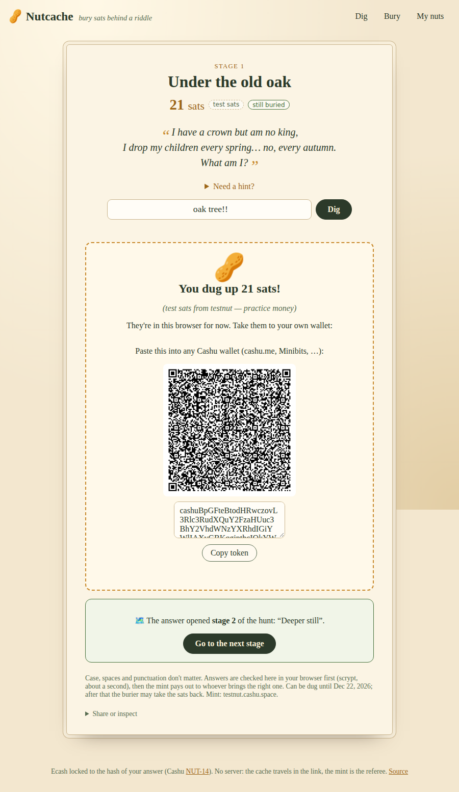

# 🥜 Nutcache — bury sats behind a riddle

**Live: https://mmajjd926-netizen.github.io/nutcache/**

Write a riddle, lock some ecash to its answer, share the link (or print the card and tape it to a tree).
Whoever figures out the answer digs the sats up, straight from the mint. Nobody else can: not you, not this
page, not a server. There is no server.

Chain riddles into a **hunt**: each answer pays out its stage *and* unlocks the next riddle, which nobody can
even read before solving the one before it.



## How it works

A nutcache is a set of Cashu proofs locked with a [NUT-14](https://github.com/cashubtc/nuts/blob/main/14.md)
hashlock. The mint will only swap them for someone who shows a preimage whose SHA-256 is the lock.

```
answer ──normalize──▶ "oak tree" ──scrypt(salt, N=2^15)──▶ 64 bytes
                                                          ├─ bytes 0..31  = preimage   → lock = sha256(preimage)
                                                          └─ bytes 32..63 = stage key  → AES-GCM key for the next stage
```

- **Burying** (`bury`): pick a mint, top up over Lightning or paste a token, write the riddle and answer.
  The page derives the preimage, locks the amount (plus the swap fee, so the solver gets the full amount)
  with `HTLC` secrets: hashlock + `locktime` + `refund` key. The refund key is made in your browser.
- **Digging** (`tryAnswer` → `claim`): the answer is checked offline first (scrypt, about a second), so
  wrong guesses never touch the mint. The right one is sent as the HTLC witness in a swap; the mint
  returns fresh proofs that only the digger holds. Take them as a token or send them to a Lightning address.
- **Who got there first** (`checkState`): NUT-07 shows the proofs spent, and the witness the mint stored
  reveals the preimage, which proves it was solved rather than taken back.
- **Taking it back** (`reclaim`): after the locktime the burier signs with the refund key and keeps
  whatever is still buried.
- **Hunts** (`seal` / `unseal`): stage *n* carries stage *n+1* deflated and AES-GCM-encrypted with stage *n*'s
  key. The key never leaves the solver's browser and is not derivable from the preimage the mint sees, so
  a claim on stage 1 reveals nothing about stage 2. If someone else dug a stage up first, the right answer
  still opens the next one: the hunt goes on.
- **Sharing**: the whole cache (riddle, proofs, salt, lock) is deflated into the link: `…/#/c/nc1…`.
  Fragments are never sent to a server. "Put it on the map" posts a normal Nostr note (`#nutcache`,
  with the cache in a tag and the lock in an indexed `x` tag), which makes a short link and QR possible:
  `…/#/x/<lock>`. The map on the front page is those notes, checked against the mint.

## Things that were not obvious

- **Answers are normalized** before hashing: Unicode NFKC, lower case, punctuation and spacing ignored,
  and a leading *a / an / the* dropped. "An oak tree!" and "oak tree" open the same nut.
- **Offline guessing is the real attack**: the lock and salt are public, so anyone can try a dictionary
  without asking the mint. scrypt (32 MiB, ~1 s per guess in a browser) makes that slow, the per-cache salt
  makes precomputation useless, but an answer that is a single common word will fall to a determined
  attacker with a GPU. Pick answers with a little shape ("the third oak by the lake") for bigger prizes.
- **Refunds on today's mints**: cashu-ts signs an HTLC refund with a witness that has `signatures` but no
  `preimage`. CDK mints up to 0.18.x (testnut, Minibits) parse that as a P2PK witness and answer
  *"Secret is not a HTLC secret"*. Fixed in CDK main ([cdk#2641](https://github.com/cashubtc/cdk/pull/2641));
  until mints upgrade, `reclaim` retries with `"preimage": ""`, which both checks accept.
  The live test locks 8 sats for 4 seconds and takes them back.
- **No DLEQ in the link**: it would double the size. The digger swaps at the mint at once, so a bad proof
  shows up there.
- **Hostile links**: a link chooses its own scrypt parameters, so they are capped (N ≤ 2^18, r ≤ 16, p ≤ 4)
  and every text is escaped.

## Run it

```
npm install
npm run dev                 # http://localhost:5173
npm test                    # 9 tests: normalization, KDF, sealing, link format
NUTCACHE_LIVE=1 npx vitest run   # + live on testnut: bury → wrong answer refused → right answer paid → status; refund after locktime; a 2-stage hunt
npx vite build && npx vite preview --port 4174 & node tools/e2e.mjs
                            # two headless browsers: top up, bury a 2-stage hunt, dig both stages, receive the prize token in another wallet
```

The default mint is testnut (free test sats that pay their own invoices), so you can try everything without money.
Real sats: Minibits, or any mint that supports NUT-14 (the page refuses a hashlock on a mint that doesn't
advertise it, since such a mint would treat the proofs as bearer tokens).

Code: [`src/core/cache.ts`](src/core/cache.ts) (all the Cashu), [`src/core/board.ts`](src/core/board.ts) (Nostr),
[`src/main.ts`](src/main.ts) (UI). Built on [cashu-ts](https://github.com/cashubtc/cashu-ts), noble-hashes/ciphers, nostr-tools.

Made for [Nut November](https://nutnovember.org/) 2026. MIT.
